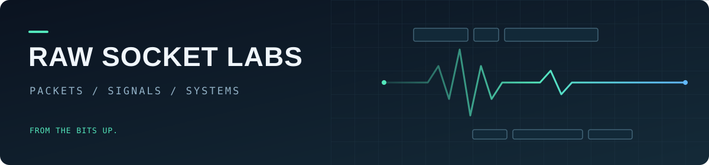

We build tools for working closer to the wire: binary codecs, network protocols,
radio hardware, and hardware-backed identity.

### Explore the lab

| Project | What it does | Start here |
| :--- | :--- | :--- |
| **[rsl](https://github.com/RawSocketLabs/rsl)** | A Rust monorepo for codecs, protocols, cryptography, device drivers, and hardware bindings. Individual crates, developed together. | [Workspace guide](https://github.com/RawSocketLabs/rsl#readme) |
| **[ykt](https://github.com/RawSocketLabs/ykt)** | A YubiKey-backed offline certificate authority for short-lived SSH and mTLS certificates. | [Quickstart](https://github.com/RawSocketLabs/ykt#quickstart) · [Releases](https://github.com/RawSocketLabs/ykt/releases) |

### Inside `rsl`

- **Encode the bits** → [bitsandbytes](https://github.com/RawSocketLabs/rsl/tree/main/codecs/bitsandbytes)
- **Speak the protocols** → [network stack](https://github.com/RawSocketLabs/rsl/tree/main/protocols)
- **Reach the hardware** → [device drivers](https://github.com/RawSocketLabs/rsl/tree/main/devices) · [native bindings](https://github.com/RawSocketLabs/rsl/tree/main/bindings)

### Work with the code

Start with each project's README for setup, supported features, and build
requirements. For questions, bugs, or proposed changes, use the relevant
repository's issues and contribution guidance.

[Browse public repositories](https://github.com/orgs/RawSocketLabs/repositories?type=public)
